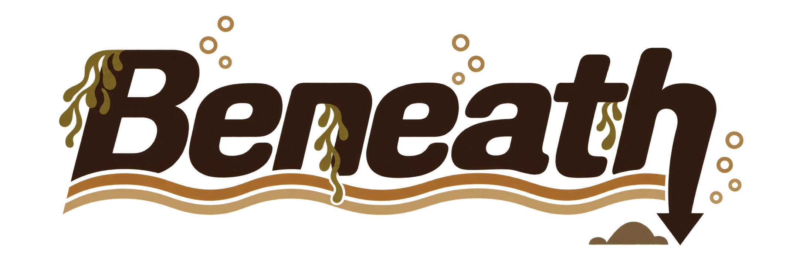

# Beneath



Beneath is a playable underwater acoustic environment by **Monke Mountain Studios**. It places any incoming sound inside a small geometric world of distance, depth, moving water, surface reflections and a material seabed. Feed it an instrument, field recording, voice or complete mix and explore rather than hunt through presets—Beneath intentionally ships without factory presets.

## Playing the aquarium

- **Drag the Speaker** to move the incoming sound horizontally and change its depth.
- **Drag the Hydrophone** to choose where the underwater result is heard.
- Moving either device sideways also changes their acoustic distance.
- **Drag the Air Stone** along the seabed to position the bubble source.
- Click **Waves**, **Rain**, **Marine** or **Bubbles** to enable that environment and open its controls. Click the aquarium to close the control row.
- Use the side **Input** and **Output** faders for level, and **Mix** for the dry/wet balance.
- Open **Settings** for water depth, rising seabed, current, Dream Physics, distance reverb, seabed material and environmental pause.
- Move over the boat and drag its mast vertically to discover the Jolly Roger feedback control. Its protected 0–90% range moves from quiet reflections into controlled chaos, then bends sharply toward self-sustaining mayhem over the final five points. There is no remaining 10%: beyond that, gravity stops working and you may receive a visit from Pazuzu.

Speaker and hydrophone position, distance, moving water and seabed material all affect the signal path. Extreme combinations are intentionally capable of becoming wild; lower the flag, Mix or Input if the sea starts winning.

## Audio model

Beneath combines:

- direct, surface-reflected and seabed-reflected propagation paths;
- distance- and depth-dependent filtering;
- mud, sand, gravel, rock and coral responses;
- current-driven delay movement and reflection feedback;
- a dark distance-fed diffuse field;
- procedural waves, rain, air bubbles and distant marine calls;
- a safeguarded high-feedback path with low-cut filtering, damping and limiting.

## Downloads

Windows VST3/standalone and macOS universal VST3/AU/standalone builds are available from the [Releases](https://github.com/Monkemountainstudios/Beneath/releases) page.

On Windows, place the `Beneath.vst3` bundle in your system VST3 folder (normally `C:\Program Files\Common Files\VST3`) and rescan plugins in your host. The standalone executable can be run directly.

On macOS, copy `Beneath.vst3` to `/Library/Audio/Plug-Ins/VST3`, `Beneath.component` to `/Library/Audio/Plug-Ins/Components`, or run `Beneath.app` directly. Public macOS builds are currently unsigned and not notarized.

## Building from source

Beneath uses [JUCE](https://juce.com/) and CMake 3.22 or newer. Point `BENEATH_JUCE_SOURCE_DIR` at a JUCE checkout when it is not available at `F:/JUCE`.

```powershell
cmake -S . -B build -G Ninja -DCMAKE_BUILD_TYPE=Release -DBENEATH_JUCE_SOURCE_DIR=C:/path/to/JUCE
cmake --build build --config Release
ctest --test-dir build -C Release --output-on-failure
```

## Credits

- Concept, art direction, sound design, testing and final tuning: **Monke Mountain Studios**
- DSP, interface and engineering collaboration: **OpenAI Codex** and **Astra**
- Audio application and plugin framework: **JUCE**

Thank you to everyone who experiments with Beneath and finds their own musical route through the water.

